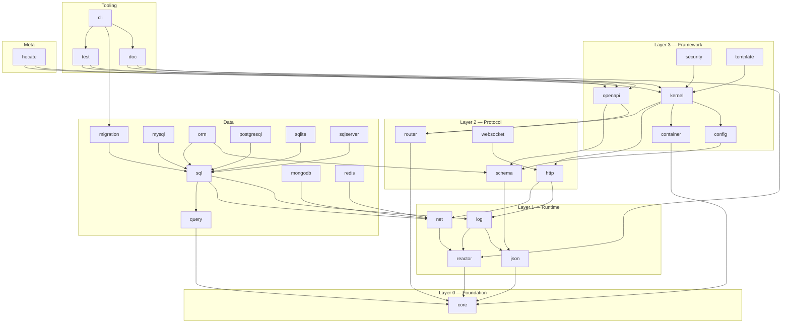
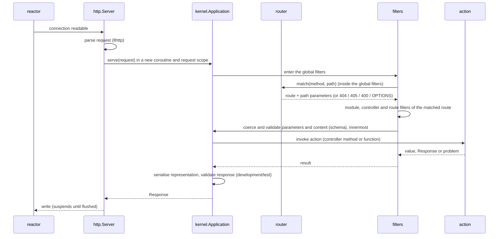

# Architecture overview

## Layers

Packages are organised in layers. **A package may depend only on packages of a lower
or the same layer** (or, for the data and tooling groups, on the layers listed). Cycles are
forbidden and checked in CI.

<!-- gen-dependency-graph:begin -->

<!-- gen-dependency-graph:end -->

The graph is generated from the rockspecs by `gen-dependency-graph`; edges implied by other edges are omitted. Each package's
README lists its exact dependencies: `http` declares `core`, `reactor`, `net`, `json` and `log` (the graph shows only `net` and `log`, which imply the others).

## Naming

- Directory: `packages/<name>/`
- Rock: `hecate-<name>` (the meta-rock is `hecate`)
- Lua module root: `hecate.<name>` (e.g. `require "hecate.router"`)
- The meta-module `hecate` re-exports the framework surface (controllers,
  routes, problem details) so that typical application code needs one `require`. It does not
  re-export the object-model entry points: applications declare classes with `core.class`
  from `hecate.core` ([OQ-57](../open-questions.md), resolved).

## Native code policy

Hecate is Lua-first. Native code is used only where Lua cannot reach the required
performance or system access:

| Need | Native component | Decision |
|---|---|---|
| Asynchronous I/O | libuv through luv | ADR 0002 |
| HTTP/1.1 parsing | llhttp | [ADR 0019](../adr/0019-http-parser-llhttp.md) |
| JSON | yyjson decoder (C), serde_json encoder (Rust) | [ADR 0020](../adr/0020-json-yyjson-decoder-serde-encoder.md), [ADR 0021](../adr/0021-rust-native-modules.md) |
| TLS | rustls through mlua | ADR 0021 |
| SQLite | SQLite amalgamation | data-access.md |
| Hashing for auth protocols (SHA-256, HMAC, PBKDF2) | undecided: OQ-4's assumption is false, see OQ-45 | OQ-45 |

C code is C11, compiled with warnings as errors, tested under AddressSanitizer and
UndefinedBehaviorSanitizer on Linux, and must build with MSVC on Windows.

Database wire protocols (PostgreSQL, MySQL, Redis, MongoDB, TDS) are implemented in Lua
on top of `hecate.net`: they then cooperate with the reactor transparently and need no
per-platform builds.

## Request lifecycle

The global filters wrap the routing step, so the `404`, `405`, `400` and automatic `OPTIONS`
answers pass through them. The filters of a feature module apply only to the routes of that
module, and the controller and route filters come after them. The inputs of the request
(path, query, header fields, cookies and content) are coerced and validated after all the
filters, just before the action (OQ-114): a filter sees the request before its validation, and
a request that fails it still passes through the filters on its way back as a `422` problem
response. See [http-and-routing.md](http-and-routing.md).

Every request runs in its own coroutine inside a **scope** (structured concurrency):
computations forked during the request are cancelled when the request completes or is
aborted. See [concurrency.md](concurrency.md).

## Boot sequence

1. Load configuration (layers, environment), validate it against its schema
   ([configuration.md](configuration.md)). Today the application's caller does it with `kernel.load_configuration`
   and passes the result as the `configuration` option; `Application:boot()` applies it but does not load it (the
   Phase 3 CLI does both for `hecate serve`).
2. Build the container graph; detect missing bindings and cycles.
3. Load modules; collect controllers and route modules; build the route table.
4. Compile schemas; verify that every route's schemas are well-formed and that every
   controller action exists (interface conformance).
5. Compile the router (radix tree) and, when enabled, the OpenAPI document.
6. Start workers and listen.

Any failure in steps 1–5 aborts the boot with a precise diagnostic. Nothing is
validated lazily at the first request.
