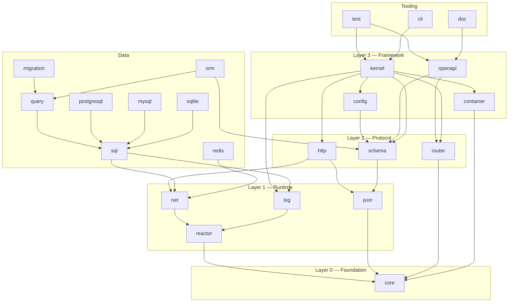
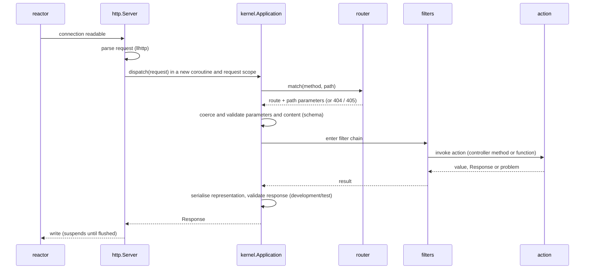

# Architecture overview

## Layers

Packages are organised in layers. **A package may depend only on packages of strictly
lower layers** (or, for the data and tooling groups, on the layers listed). Cycles are
forbidden and checked in CI.

Edges show the main direct dependencies; transitive ones are omitted. Each package's
README lists its exact dependencies.

## Naming

- Directory: `packages/<name>/`
- Rock: `hecate-<name>` (the meta-rock is `hecate`)
- Lua module root: `hecate.<name>` (e.g. `require "hecate.router"`)
- The meta-module `hecate` re-exports the framework surface (classes, controllers,
  routes, problem details) so that typical application code needs one `require`.

## Native code policy

Hecate is Lua-first. Native code is used only where Lua cannot reach the required
performance or system access:

| Need | Native component | Decision |
|---|---|---|
| Asynchronous I/O | libuv through luv | ADR 0002 |
| HTTP/1.1 parsing | llhttp | OQ-6 |
| JSON | C codec | OQ-5 |
| TLS | OpenSSL 3 (or alternative) | OQ-4 |
| SQLite | SQLite amalgamation | data-access.md |
| Hashing for auth protocols (SHA-256, HMAC, PBKDF2) | provided by the TLS library binding | OQ-4 |

C code is C11, compiled with warnings as errors, tested under AddressSanitizer and
UndefinedBehaviorSanitizer on Linux, and must build with MSVC on Windows.

Database wire protocols (PostgreSQL, MySQL, Redis, MongoDB, TDS) are implemented in Lua
on top of `hecate.net`: they then cooperate with the reactor transparently and need no
per-platform builds.

## Request lifecycle

Every request runs in its own coroutine inside a **scope** (structured concurrency):
computations forked during the request are cancelled when the request completes or is
aborted. See [concurrency.md](concurrency.md).

## Boot sequence

1. Load configuration (layers, environment), validate it against its schema.
2. Build the container graph; detect missing bindings and cycles.
3. Load modules; collect controllers and route modules; build the route table.
4. Compile schemas; verify that every route's schemas are well-formed and that every
   controller action exists (interface conformance).
5. Compile the router (radix tree) and, when enabled, the OpenAPI document.
6. Start workers and listen.

Any failure in steps 1–5 aborts the boot with a precise diagnostic. Nothing is
validated lazily at the first request.
