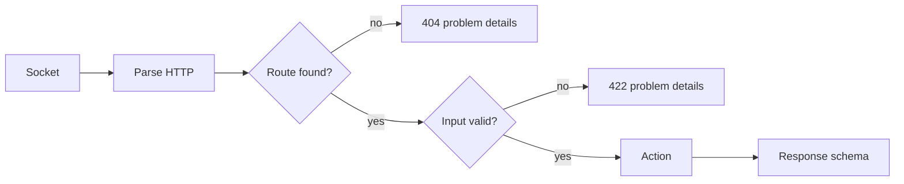

# Request flow

A request is parsed, routed, validated, then handed to the action. A validation failure never reaches the action.

The route table is built once at start. The router matches the method and the path template; the dispatcher then
validates the path parameters and the content against the schemas of the route before it calls the action.
